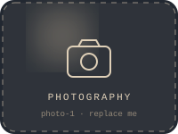
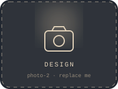
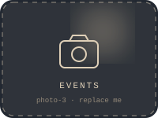
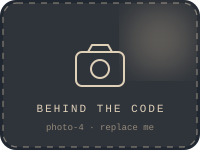

  

<table>
<tr>

<!-- ───────────── 01 · ABOUT ───────────── -->
<td width="25%" valign="top">

 

**Hi, I'm Swayanshu.**
 
B.Tech CSE undergraduate (2023–2027) at Government College of Engineering Kalahandi · CGPA 7.91.
I build secure, data-driven full-stack apps and AI-powered products — Spring Boot on the backend, React on the front.

  

**Contact**
 

 
Puri, Odisha, India

  

**Skills**
 

 
150+ LeetCode problems solved

  

**Frameworks**
 

</td>

<!-- ───────────── 02 · PROJECTS ───────────── -->
<td width="25%" valign="top">

 

**Happenstance**
 
AI-assisted networking platform
 
<code>Aug – Nov 2026</code>
 
<b>Stack:</b> React.js · Spring Boot · MongoDB · Docker · Postman
 
Similarity-based recommendation engine over 4+ profile attributes; 5+ core modules.
 
<a href="https://github.com/Swayanshu-Mallik/Happenstance_ai">View repo →</a>

  

**SecureChat**
 
Real-time end-to-end encrypted messaging
 
<code>Nov – Dec 2025</code>
 
<b>Stack:</b> Next.js · React.js · Spring Boot · MongoDB · WebSockets
 
ECDH P-256 key exchange + AES-256-GCM, client-side encryption.
 
<a href="https://github.com/Swayanshu-Mallik/static-website">View repo →</a>

  

**SEMAS**
 
Security Event Monitoring &amp; Analytics System
 
<code>Feb – May 2026</code>
 
<b>Stack:</b> <!-- TODO: add your SEMAS tech stack, e.g. Spring Boot · MongoDB · React.js -->Log ingestion · Rule-based detection · RBAC dashboard
 
Multi-source log ingestion, threat prioritization and event correlation.
 
<a href="https://github.com/Swayanshu-Mallik/SEMAS">View repo →</a>

  

**Sprout Social**
 
Influencer analytics · NoviTech R&amp;D (Internship)
 
<code>Jul – Aug 2026</code>
 
<b>Stack:</b> React.js · Node.js · Express.js · MongoDB · LLM API
 
Dashboards for 5+ metrics with AI-driven content recommendations.

</td>

<!-- ───────────── 03 · LEADERSHIP ───────────── -->
<td width="25%" valign="top">

 

**Chief Coordinator**
 
Photography Club
 
Instructed 3 workshops for 50–70 students and organized 2 intra-college photography competitions.

  

**Design Lead**
 
Quasar · 2025 &amp; 2026
 
Led the design team behind a 150+ page annual college magazine, released in print and digital.

  

**Event Photographer**
 
ICICA 2026 · CISPSSE 2026 · Insprano · Awahaan · Anugoonj
 
8,000+ photographs of international conferences and college fests.

  

</td>

<!-- ───────────── 04 · ME ───────────── -->
<td width="25%" valign="top">

 

What I do: write software, lead teams and photograph people, places and events.

  

<!--
  HOW TO ADD YOUR PHOTOS
  1. Put your image in  assets/me/  (e.g. assets/me/event.jpg)
  2. Change the src below from  assets/me/photo-1.svg  to  assets/me/event.jpg
  3. Keep width="100%" so it fits the column. Edit the title="" text — it shows on hover.
-->

 

 

 

</td>

</tr>
</table>

