<table>
<tr>
<td width="25%"></td>
<td width="25%"></td>
<td width="25%"></td>
<td width="25%"></td>
</tr>
</table>

<table>
<tr><td valign="top">

**Chief Coordinator** · Photography Club
 
Instructed 3 workshops for 50–70 students and organized 2 intra-college photography competitions.

</td></tr>
<tr><td valign="top">

**Design Lead** · Quasar · 2025 &amp; 2026
 
Led the design team behind a 150+ page annual college magazine, released in print and digital.

</td></tr>
<tr><td valign="top">

**Event Photographer** · ICICA 2026 · CISPSSE 2026 · Insprano · Awahaan · Anugoonj
 
Captured 8,000+ photographs at international conferences and college fests.

</td></tr>
</table>

   

 
<table>
<tr>
<td width="33%" align="left"><a href="projects.md">← Projects</a></td>
<td width="34%" align="center"><code>PAGE 3 / 4</code></td>
<td width="33%" align="right"><a href="me.md">Me →</a></td>
</tr>
</table>

