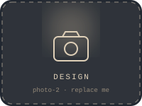

<table>
<tr>
<td width="25%"></td>
<td width="25%"></td>
<td width="25%"></td>
<td width="25%"></td>
</tr>
</table>

What I do: write software, lead teams and photograph people, places and events.

<!--
  HOW TO ADD YOUR PHOTOS
  1. Put your image in  assets/me/  (e.g. assets/me/event.jpg)
  2. Change src below from  ../assets/me/photo-1.svg  to  ../assets/me/event.jpg
  3. Edit title="" — it shows as a tooltip on hover.
-->
<table>
<tr>
<td width="50%"></td>
<td width="50%"></td>
</tr>
<tr>
<td width="50%"></td>
<td width="50%"></td>
</tr>
</table>

 
<table>
<tr>
<td width="33%" align="left"><a href="leadership.md">← Leadership</a></td>
<td width="34%" align="center"><code>PAGE 4 / 4</code></td>
<td width="33%" align="right"><a href="../README.md">Back to About ↺</a></td>
</tr>
</table>

