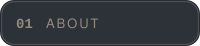
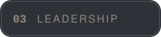
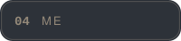

<table>
<tr>
<td width="25%"></td>
<td width="25%"></td>
<td width="25%"></td>
<td width="25%"></td>
</tr>
</table>

<table>
<tr>
<td width="22%" valign="top"><code>Aug – Nov 2026</code></td>
<td valign="top">

**Happenstance** · AI-assisted networking platform
 
Similarity-based recommendation engine over 4+ profile attributes; 5+ core modules including profile management, people search and connection requests.
 
<b>Stack:</b> React.js · Spring Boot · MongoDB · Docker · Postman
 
<a href="https://github.com/Swayanshu-Mallik/Happenstance_ai">View repository →</a>

</td>
</tr>
<tr>
<td width="22%" valign="top"><code>Nov – Dec 2025</code></td>
<td valign="top">

**SecureChat** · Real-time encrypted messaging
 
End-to-end encryption using ECDH P-256 key exchange and AES-256-GCM, with authenticated WebSockets.
 
<b>Stack:</b> Next.js · React.js · Spring Boot · MongoDB · WebSockets
 
<a href="https://github.com/Swayanshu-Mallik/static-website">View repository →</a>

</td>
</tr>
<tr>
<td width="22%" valign="top"><code>Feb – May 2026</code></td>
<td valign="top">

**SEMAS** · Security Event Monitoring &amp; Analytics
 
Centralized platform for multi-source log ingestion, threat prioritization and event correlation.
 
<b>Stack:</b> <!-- TODO: add your real SEMAS tech stack -->Log ingestion · Rule-based detection · RBAC dashboard
 
<a href="https://github.com/Swayanshu-Mallik/SEMAS">View repository →</a>

</td>
</tr>
<tr>
<td width="22%" valign="top"><code>Jul – Aug 2026</code></td>
<td valign="top">

**Sprout Social** · Influencer analytics · NoviTech R&amp;D (Internship)
 
Dashboards for 5+ metrics with AI-driven content recommendations.
 
<b>Stack:</b> React.js · Node.js · Express.js · MongoDB · LLM API

</td>
</tr>
</table>

 
<table>
<tr>
<td width="33%" align="left"><a href="../README.md">← About</a></td>
<td width="34%" align="center"><code>PAGE 2 / 4</code></td>
<td width="33%" align="right"><a href="leadership.md">Leadership →</a></td>
</tr>
</table>

